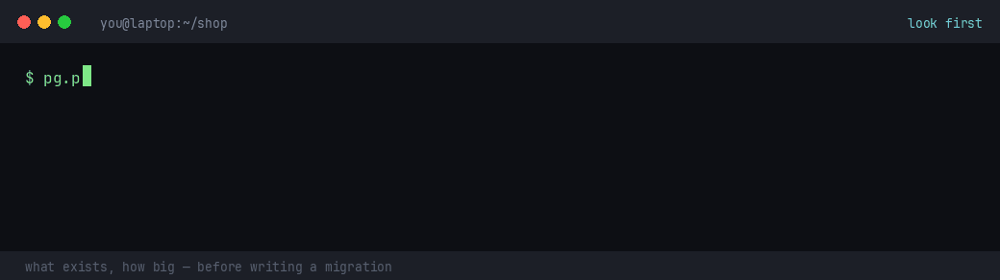

# pg-inspect

<h3 align="center">Read-only Postgres inspection that is structurally unable to write.</h3>

<p align="center">
  <a href="LICENSE"></a>
  
  
  
  
</p>

<p align="center">
  
</p>

## What it is

`pg-inspect` is a **read-only Postgres inspector with 34 commands**, in one call per question.

**Start with `audit`** — it runs every health check and prints one prioritised report: unused indexes,
foreign keys with no supporting index, dead-tuple bloat, transaction-ID age, sequences near exhaustion,
lock waits, connection pressure, missing `pg_stat_statements`.

Then ask for what you need:

| Group | Commands |
| --- | --- |
| **Shape** | `overview` · `tables` (sizes, bars, dead tuples, scan counters) · `schema orders` · `ddl orders` · `erd` (mermaid or terminal) · `fk` · `profile orders` (nulls, distinct, most-common values) · `sample orders` |
| **Drift** | `fingerprint` — a schema hash · `fingerprint --against postgres://staging/…` — exactly what differs, without dumping either database |
| **Queries** | `q "select …"` · `explain "select …"` (plan tree, cost bars, warnings — never executes) · `slow --by=total|mean` · `long-running --minutes=5` |
| **Indexes** | `indexes` (size, scans, unused, duplicates, invalid) · `unused-indexes` · `duplicate-indexes` · `missing-fk-indexes` |
| **Health** | `audit` · `bloat` · `vacuum` · `seq-scans` · `cache` (hit ratios, temp spill, deadlocks) · `xid` · `sequences` · `replication` · `connections` |
| **Safety & ops** | `grants orders` · `rls` · `locks` (blocking tree) · `activity` · `sizes` · `migrations` · `search invoice` · `doctor` |

Every command takes `--json`, `--csv` or `--md` (so it can feed a script, a spreadsheet or a PR).
Output is a box table with aligned numbers, human sizes, magnitude bars and a `— rows · ms` footer;
colour appears only on a TTY (`NO_COLOR=1` to disable), so logs stay clean.

```bash
$ pg.py audit
audit  0 critical · 2 warn · 1 info
  WARN  unused index products.products_name_unused_idx
        16.0 kB, never scanned
  WARN  foreign key without index: order_notes(order_id)
        references orders; deletes scan the child
  INFO  pg_stat_statements missing
        install it to enable `slow` and query-level triage
```

## The problem it removes

Without it, every session retypes
`PGPASSWORD=… psql -h … -U … -d … -c "…"` and parses whatever comes back — 1,115 times in the history
this came from. That is slow, ugly, and one typo away from a write on production. Here the connection
comes from `DATABASE_URL` or libpq env vars and the write path does not exist.

## Install

```bash
# any agent, via the skills CLI — this one, or all twelve at once
npx skills add Appit-labs/pg-inspect -g -y
npx skills add Appit-labs/appit-skills -g -y

# Claude Code — the whole collection as one marketplace
claude plugin marketplace add Appit-labs/appit-skills
claude plugin install pg-inspect@appit-skills

# pi
pi install git:github.com/Appit-labs/pg-inspect

# any agent that reads a skills directory
git clone git@github.com:Appit-labs/pg-inspect.git
cp -r pg-inspect/skills/pg-inspect ~/.claude/skills/      # or ~/.codex/skills/, .cursor/skills/, …
```

## Use

- **Shape of the data** — `scripts/pg.py tables` · `schema orders` · `search invoice`
- **A question** — `scripts/pg.py q "select status, count(*) from orders group by 1"`
- **A plan** — `scripts/pg.py explain "select …"` — plans, does not execute
- **Health** — `migrations` · `locks` · `activity` · `sizes --limit=15`

## What it does not do

- It cannot write: statements are refused before connecting, and the session runs with `default_transaction_read_only=on`.
- It is not a migration tool — to change data you use yours, deliberately.

## Requires

- `psql` on PATH (the server can be anywhere).
- A connection: `--url`, `$DATABASE_URL`, or libpq `PGHOST/PGUSER/PGPASSWORD/PGDATABASE`.
- Python 3.9+ (stdlib only).

## Cost

| | tokens |
| --- | --- |
| always-on — the description, paid every session | ~95 |
| on invoke | ~0.7k |

The demo above is not a mockup: `demos/pg-inspect.json` holds the captured run and
`tools/make_demo.py` renders it, so it can be regenerated and audited.

## Provenance

Every command in this skill was run against a real target before it was written down: a live
database, a staging host, a failing CI run, a browser session. The repository was created and
published on 2026-11-18; where the workflow itself is older, `CHANGELOG.md` carries the dates.

## Security

SkillSpector: **0/100, SAFE, 0 open findings** against the committed baseline. Every accepted
finding is listed with its reason in [SECURITY.md](SECURITY.md). No `shell=True`, no credential
storage, no network destination chosen at runtime.

## Part of the Appit collection

All twelve, one install: `npx skills add Appit-labs/appit-skills -g -y`.

- [`live-qa`](https://github.com/Appit-labs/live-qa) — live QA in a real browser
- [`ci-triage`](https://github.com/Appit-labs/ci-triage) — red CI to the failing line
- [`pg-inspect`](https://github.com/Appit-labs/pg-inspect) — read-only Postgres inspection ← this skill
- [`repo-runbook`](https://github.com/Appit-labs/repo-runbook) — the verified runbook in AGENTS.md
- [`remote-exec`](https://github.com/Appit-labs/remote-exec) — SSH that cannot hang
- [`trello-tickets`](https://github.com/Appit-labs/trello-tickets) — seven ticket types, one card
- [`cloud-browser`](https://github.com/Appit-labs/cloud-browser) — hosted browsers that stop billing
- [`open-design`](https://github.com/Appit-labs/open-design) — the OpenDesign monorepo
- [`blender-pipeline`](https://github.com/Appit-labs/blender-pipeline) — Blender via MCP
- [`code-scan`](https://github.com/Appit-labs/code-scan) — Skylos + Fallow, one gate
- [`release`](https://github.com/Appit-labs/release) — conventional commits to a tag
- [`hermes-setup`](https://github.com/Appit-labs/hermes-setup) — least-privilege agent wiring


## License

MIT, copyright Appit Labs. See [LICENSE](LICENSE).
